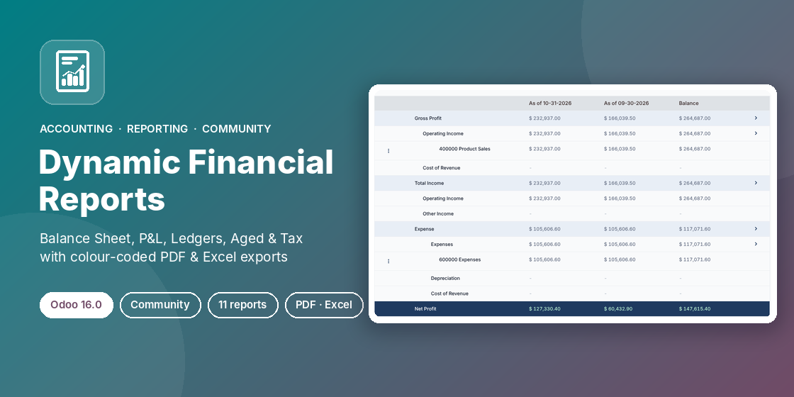

# Dynamic Financial Reports (Community)



Eleven interactive accounting reports for **Odoo Community**: filter and compare periods on screen, drill down to journal items, and export colour-coded **PDF** and **Excel** files.

| Statements | Ledgers | Receivables / payables | Other |
|---|---|---|---|
| Balance Sheet | General Ledger | Partner Ledger | Tax Report |
| Profit and Loss | Trial Balance | Aged Receivable | Consolidated Journals |
| Cash Flow Statement | | Aged Payable | |
| Executive Summary | | | |

## Branches

One branch per Odoo version; each holds the code ported to and tested on that version.

| Branch | Odoo version |
|---|---|
| [`16.0`](../../tree/16.0) (default) | 16.0 Community & Enterprise |
| [`17.0`](../../tree/17.0) | 17.0 Community & Enterprise |
| [`18.0`](../../tree/18.0) | 18.0 Community & Enterprise |
| [`19.0`](../../tree/19.0) | 19.0 Community & Enterprise |
| [`20.0`](../../tree/20.0) | 20.0 Community & Enterprise |

## Features

- **Filters**: date presets or custom dates, comparison with N previous periods or a custom period, journals and journal groups, accounts, analytic accounts, partners, receivable/payable, posted/draft, reconciled/unreconciled.
- **Drill-down**: expand sections down to accounts and journal items; open the journal items or the General Ledger of any account.
- **PDF**: company header with logo, title, period, print date and page numbers; filter summary; navy column header repeated on every page. The header band has a fixed height inside the reserved margin, so it never overlaps the table head. Statements print in portrait; ledgers, Trial Balance and aged reports in landscape.
- **Excel**: navy headers, highlighted totals, thousands separators, red negatives, A4 landscape page setup.
- **Same colours everywhere** (browser, PDF, Excel): negatives in red, zeros as a grey dash, sections tinted, grand totals on a navy band.
- **E-mail**: the envelope button sends the PDF to your own address.

## Installation

1. Copy the `accounting_dynamic_reports_community` folder into your addons path, or add this repository to your Odoo.sh project (on the branch matching your Odoo version).
2. Update the Apps list and install **Dynamic Financial Reports (Community)**.
3. Open **Invoicing / Accounting › Reporting › Dynamic Reports**.

Dependencies: `account` only (Python: `xlsxwriter`, shipped with Odoo).
PDF rendering needs wkhtmltopdf **0.12.6 with patched Qt** (the build recommended by Odoo and used on Odoo.sh).

## Settings

**Settings › Invoicing › Dynamic Financial Reports**

- **Enable Ledger Initial Balance**: show the initial balance in the General and Partner Ledger.
- **Disable Trial Initial Balance**: move income/expense initial balances to Current Year Earnings in the Trial Balance.
- **Disable Balance Sheet Sign**: show Assets and Liabilities without a negative sign.
- **Enable Net Tax**: show the net tax line in the Tax Report.

## Security

| Group | Access |
|---|---|
| Billing (`account.group_account_invoice`) | Open all reports, use filters, export |
| Read-only (`account.group_account_readonly`) | Same as Billing |
| Billing Administrator (`account.group_account_manager`) | Also create and delete report definitions |
| Portal / other users | No access |

Journal items are always read through Odoo's record rules, and only the companies selected in the company switcher are reported.

## Tests

```bash
odoo-bin -d <db> -u accounting_dynamic_reports_community \
    --test-enable --test-tags /accounting_dynamic_reports_community --stop-after-init
```

The suite checks that every report computes; that the Trial Balance and Balance Sheet balance; that there are no duplicated rows; that the P&L, Executive Summary and comparison columns match the journal items; the General Ledger and aged totals; the draft filter; Excel and PDF for all reports; access rights; multi-company isolation; and e-mail sending.

## Author

**Ibrahim Yahia** · [LinkedIn](https://www.linkedin.com/in/ibrahim-yahia) · ibrahim.yahiah@gmail.com

License: LGPL-3
